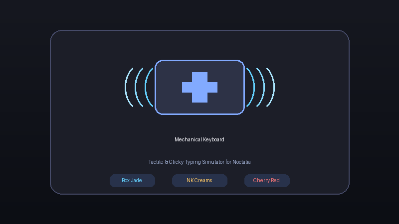

# noctalia-mech-keys ⌨️🔊

> Authentic mechanical keyboard sound feedback plugin for the [Noctalia](https://github.com/noctalia-dev) desktop shell on Wayland & Linux.



---

## Overview

Missing the satisfying tactile sound of your mechanical keyboard when working on a laptop? **noctalia-mech-keys** brings the click and thock directly to your desktop audio with sub-5ms response time and native Noctalia Shell integration.

### Switch Profiles Included

| Profile | Switch Type | Sound Characteristic |
| :--- | :--- | :--- |
| **Kailh Box Jade** | Clickbar Clicky | Crisp, tactile, loud snap |
| **NovelKeys Creams** | POM Linear | Deep, buttery, smooth "thock" |
| **Cherry MX Red** | Linear | Classic soft mechanical clack |

---

## Installation via Noctalia Plugin Store

1. Open **Noctalia Settings** (`Super + S` or via the Control Center).
2. Go to **Plugins** → **Sources** tab.
3. Click **Add Plugin Source**:
   * **Name:** `noctalia-mech-keys`
   * **URL:** `https://github.com/<your-username>/noctalia-mech-keys`
4. Go to **Available Plugins**, find **Mechanical Keyboard**, and click **Install**!
5. Add the **Mechanical Keyboard** widget to your bar in **Settings → Bar → Widgets**.

---

## Local Development / Direct Install

If you want to test or run it locally directly from your filesystem:

```bash
# Clone the repository
git clone https://github.com/<your-username>/noctalia-mech-keys.git

# Link or copy into your Noctalia plugins folder
mkdir -p ~/.config/noctalia/plugins
ln -s "$(pwd)/noctalia-mech-keys/mech-keys" ~/.config/noctalia/plugins/mech-keys

# Ensure you have input group permissions
sudo usermod -aG input $USER
```

---

## Bar Widget Controls

* **Left-Click:** Instant Mute / Unmute toggle
* **Right-Click:** Cycle through switch profiles (Box Jade → Creams → Cherry Red)
* **Hover:** Displays current active profile and status tooltip

---

## Settings Configuration

* **Enable / Disable Sound:** Global toggle
* **Switch Profile:** Dropdown selector with live hot-switching
* **Volume Slider:** Adjust volume from 0% to 100%
* **Keyboard Device:** Auto-detect all connected keyboards or select internal/external specifically
* **Preview Button:** Test the sound profile without typing

---

## Architecture

* **Engine:** Pure C low-latency playback engine powered by `miniaudio` and Linux kernel `/dev/input/` events.
* **UI:** Native QML / Quickshell integrated into Noctalia's Material-inspired design system.
* **Zero Dependencies:** Compiles with GCC; no Python packages, Rust toolchains, or heavy frameworks required.

---

## License

MIT © [Shreyas](https://github.com/shreyas)
